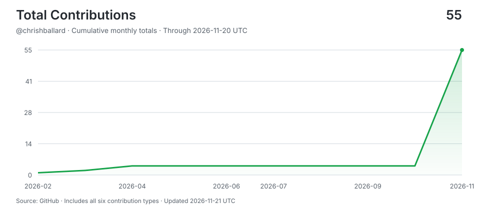

# chrishballard

> Shipping with AI agents around the clock -- human hours for thinking, machine hours for doing.
>
> Stats auto-updated by [aidevops](https://aidevops.sh).

<!-- STATS-START -->
## Work with AI

| Metric | Yesterday | Prior 7 Days | Prior 28 Days | Prior 365 Days |
| --- | ---: | ---: | ---: | ---: |
| Screen time (Mac) | 6.5h | 35.1h | 35.1h | ~1830h* |
| Input activity (Mac) | unavailable | unavailable | unavailable | unavailable |
| Interactive human attention | 0.0h | 0.0h | 0.0h | 2.7h |
| Interactive AI generation | 0.0h | 0.0h | 0.0h | 0.5h |
| Worker-classified human attention | 0.0h | 0.0h | 0.0h | 0.0h |
| Worker/headless AI generation | 0.0h | 0.0h | 0.0h | 29.8h |
| Additive observed work | 0.0h | 0.0h | 0.0h | 33.0h |
| Interactive sessions | 0 | 0 | 0 | 12 |
| Worker sessions | 0 | 0 | 0 | 637 |

_Screen time from macos-pmset-display-assertions; collection status: ok. *365-day estimate uses observed calendar coverage._

_Input activity from macos-input-activity (time from each keyboard, mouse or trackpad input until 5 idle minutes); collection status: unavailable (no-input-activity-samples)._

_Periods are completed local calendar days ending at midnight; today is excluded._

_Human attention is unioned wall-clock time, so overlapping sessions are not double-counted. AI generation is additive machine work across sessions; it is not wall-clock concurrency._

_AI session 365-day totals cover 119 days of local assistant session history (not extrapolated)._

## AI Model Usage (all time)

| Model | Requests | Input | Output | Cache read | Cache write | Cache Hit-Rate % | Session Count | Session Hours |
| --- | ---: | ---: | ---: | ---: | ---: | ---: | ---: | ---: |
| claude-sonnet-4-6 | 7,652 | 8K | 2.9M | 319.4M | 31.4M | 91.0% | 643 | — |
| claude-opus-4-5 | 68 | 115 | 11K | 1.8M | 348K | 84.1% | 5 | — |
| claude-opus-4-6 | 32 | 44 | 19K | 3.5M | 173K | 95.4% | 1 | 0.1h |
| **Total** | **7,752** | **8K** | **2.9M** | **324.8M** | **31.9M** | **91%** | **649** | **—** |

_359.8M total tokens processed. 91% cache hit rate._
<!-- STATS-END -->

<!-- PROJECTS-START -->
## Projects

- **[local-seo-skills](https://github.com/chrishballard/local-seo-skills)** -- Local SEO skills for Claude Code — NAP checker and SEO audit
<!-- PROJECTS-END -->

<!-- CONTRIBUTIONS-START -->
<!-- CONTRIBUTIONS-END -->

## Connect

---

<!-- UPDATED-START -->
_Stats auto-updated 2026-11-17 17:03 UTC by [aidevops](https://aidevops.sh) pulse._
<!-- UPDATED-END -->

<!-- TOTAL-CONTRIBUTIONS-START -->

  <a href="https://commit-history.com/chrishballard?metric=total" target="_blank" rel="noopener noreferrer">
    <picture>
      <source media="(prefers-color-scheme: dark)" srcset="assets/contributions/total-dark.svg" />
      
    </picture>
  </a>

[Verify on commit-history.com](https://commit-history.com/chrishballard?metric=total) · [Chart data](assets/contributions/total.json)

Includes commits, issues, pull requests, reviews, repositories, and restricted contributions. Refreshed daily through the prior UTC day; commit-history.com may use a different refresh cutoff. GitHub controls link navigation—Ctrl/Cmd-click opens verification in a new tab.
<!-- TOTAL-CONTRIBUTIONS-END -->
